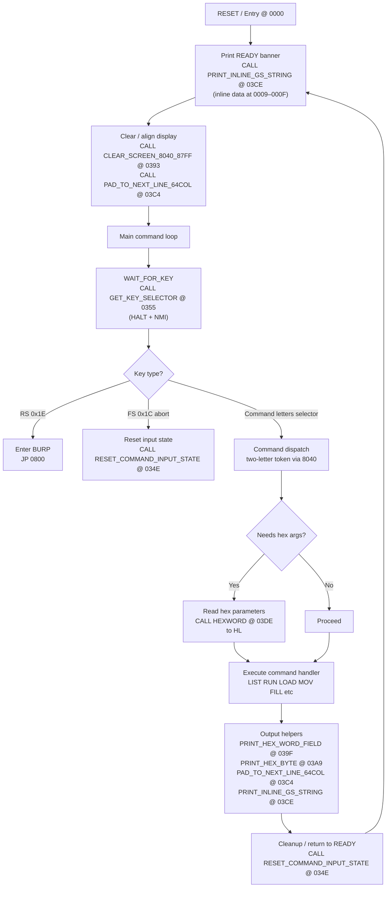

# PSI COMP-80 Monitor — Control Flow & Key Mechanisms

This document summarises the **COMP-80 monitor firmware (first 1 KB of ROM)**:
- overall control flow
- keyboard handling (HALT + NMI)
- command dispatch mechanism
- key helper routines and their roles

It is intended to accompany the annotated disassembly files (`comp80_monitor_0000_03FF_annotated_v*.asm`).

---

## High-level monitor control flow



---

## Keyboard handling: HALT + NMI design

The COMP-80 monitor uses a **HALT-driven keyboard model**:

1. The mainline executes `HALT` while waiting for a key.
2. A keypress generates an **NMI**.
3. The NMI handler (vector `0066`) verifies safety:
   - It checks that the interrupted instruction was actually `HALT (0x76)`.
   - If not, it jumps to `0000` (monitor reset).
4. The NMI handler:
   - Reads the keyboard port
   - Inverts active-low signals (`CPL`)
   - Normalises the keycode (letters → 1..26, CR → US, etc.)
   - Returns via `RETN`
5. Execution resumes *after* the HALT, with register **A containing the keycode**.

This design guarantees:
- keys are only accepted when the monitor is ready
- spurious NMIs reset the system into a known-safe state

---

## Command input & dispatch mechanism

### First-letter latch at 0x8040

- The **first command letter** typed is stored at **0x8040**.
- Letters are stored as **5-bit values**: `A=1 … Z=26`.

### Second letter triggers dispatch

When the second letter arrives, the monitor:
1. Reloads the first letter from `0x8040`
2. Combines the two letters into a compact token:
   ```
   token = (first_letter << 5) | second_letter
   ```
3. Compares the token (or a selector byte) against constants
4. Jumps to the appropriate command handler

This avoids ASCII string parsing and is very ROM-efficient.

---

## Important helper routines

### PRINT_INLINE_GS_STRING — `03CE`
Prints inline text terminated by **GS (0x1D)** using a stack/return-address trick:
- `CALL 03CE`
- return address becomes pointer to inline data
- routine prints bytes until GS
- return address is updated to skip past the data

Used for READY banner and short status messages.

---

### GET_KEY_SELECTOR — `0355`
Main keyboard entry routine:
- Performs multiple HALT-based samples
- Debounces keypress and release
- Produces a stable selector value used by the dispatcher

---

### RESET_COMMAND_INPUT_STATE — `034E`
Resets command parser state:
- clears first-letter latch
- resets buffer pointer to 0x8040
- prepares monitor for a fresh command

Called after:
- command completion
- abort (FS)
- errors

---

### HEXWORD / HEXBYTE / HEXDIGIT — `03DE / 03E7 / 03F6`
Hex input helpers:
- `HEXWORD` reads 4 hex digits → HL
- `HEXBYTE` reads 2 hex digits → A
- `HEXDIGIT` reads 1 hex digit → 0..15

Used by nearly all commands that accept addresses or ranges.

---

### PAD_TO_NEXT_LINE_64COL — `03C4`
Outputs spaces until the cursor is aligned to the next **64-column boundary**.
Used for newline behaviour and display alignment.

---

### CLEAR_SCREEN_8040_87FF — `0393`
Clears the display buffer (`0x8040–0x87FF`) by filling it with spaces.
Used on reset and before major output modes.

---

### PRINT_HEX_WORD_FIELD — `039F`
Prints `HL` as four hex digits followed by a space.
Used for address and parameter fields.

---

### PRINT_HEX_BYTE — `03A9`
Prints the byte at `(HL)` as two hex digits.
Core routine used by LIST / memory dump commands.

---

## Control characters used by the monitor

| Code | Name | Meaning in monitor |
|----|----|---------------------|
| 0x1C | FS | Abort / escape |
| 0x1D | GS | End-of-inline-string |
| 0x1E | RS | Enter BURP system |
| 0x1F | US | Internal end-of-line marker |

---

## Summary

The COMP-80 monitor is a compact, well-structured ROM:
- HALT+NMI keyboard handling provides robustness
- two-letter command dispatch is fast and ROM-efficient
- reusable helper routines keep code size small
- inline data tricks simplify message printing

This document is intended as a **roadmap** when navigating the annotated disassembly.
