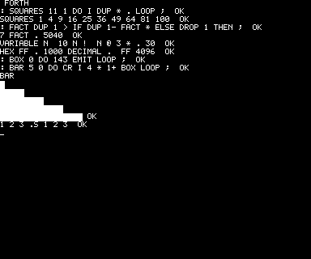

# COMP80 FORTH

A small FORTH for the PSI COMP80 that replaces BURP in the ROM. The monitor
(0000-03FF) is unchanged; FORTH fills the 2 KB at 0400-0BFF where BURP was.
As with BURP, you enter it with the RS key from the monitor's READY state.

## Running it

The MAME driver has both ROMs as BIOS options; BURP is the default.

    ~/localdev/psicomp80/c80.sh forth

or by hand:

    cd ~/localdev/mame && ./mamed psicomp80 -bios forth

then press `^` (RS) at READY. The top line changes to FORTH and a `_` cursor
appears. Type a line and press Return; the line runs and FORTH prints `OK`.

## Example programs

`examples/` has five programs to type in (or let `c80.sh` type them):

| | |
|---|---|
| `life.fs` | Game of Life, 64 × 31 cells, one per character. `1000 LIFE` runs 1000 generations from a random board; about 3 s a generation in the emulator. `~/localdev/psicomp80/c80.sh forthlife` |
| `mandel.fs` | The Mandelbrot set, one point per character, shaded by escape time, in fixed point (90 = 1.0). `MANDEL` draws it in about 95 s. `~/localdev/psicomp80/c80.sh mandel` |
| `sier.fs` | The Sierpiński triangle: Pascal's triangle mod 2, where entry x of row y is odd when `x AND y` is x. 64 rows, four cells to a character, over the whole screen. `SIER` draws it in about 10 s; a key clears it. `~/localdev/psicomp80/c80.sh forthsier` |
| `hilbert.fs` | A level-5 Hilbert curve, 32 × 32 points, drawn over the whole screen by a turtle: HIL calls itself four times, the sign of its angle mirroring the copies. `HILBERT` draws it in about 10 s; a key clears it. `~/localdev/psicomp80/c80.sh forthhilbert` |
| `hanoi.fs` | The Towers of Hanoi, animated: each disc lifts off its peg, slides across and drops onto the next. `6 HANOI` makes 63 moves in about 75 s; up to `10 HANOI` fits. `SPEED` sets the pause between steps. `~/localdev/psicomp80/c80.sh forthhanoi` |

`load.lua` does the typing: it enters FORTH, types the file a line at a time
(waiting for FORTH's cursor between lines, since a key while FORTH is busy
resets to the monitor) with the emulator running flat out, then types the
run command at normal speed. `screens/` has screenshots of Life and Mandelbrot, also on
`screenshots.html`.

## Keys

| Key | What it does |
|---|---|
| Return | run the line |
| `^` (RS) | rub out the last character. In MAME, Backspace does the same. |
| Ctrl+`\` (FS) | back to the monitor |
| any key while a word is running | stops it: the COMP80 resets to the monitor (READY) |
| `^` at READY | back into FORTH, with your words still there |

The keyboard is upper case only, and `_` acts as Return (the monitor's
keyboard handling, which the ROM keeps). The `\` key can't be typed in FORTH.

## Words

| | |
|---|---|
| Stack | `DUP DROP SWAP OVER ROT >R R> I J` |
| Arithmetic | `+ - * / MOD /MOD NEGATE 1+ 1-` (16-bit signed; `/` rounds towards zero) |
| Logic and tests | `AND OR XOR 0= 0< = < >` (true is -1) |
| Memory | `@ ! C@ C! +! HERE , ALLOT` |
| Output | `. .S EMIT CR SPACE AT PAGE WORDS ."` |
| Input | `KEY` |
| Numbers | `BASE HEX DECIMAL` (numbers may start with `-`) |
| Defining | `: ; VARIABLE CONSTANT` |
| Control | `IF ELSE THEN BEGIN UNTIL AGAIN WHILE REPEAT DO LOOP +LOOP EXIT` |
| Other | `( COLD BYE` |

Notes:

- A word can call itself by name (it is visible as soon as `:` names it), e.g.
  `: FACT DUP 1 > IF DUP 1- FACT * ELSE DROP 1 THEN ;`. Because of this,
  `: X ... X ... ;` calls the new X, not an older one.
- `." text"` prints at once when typed at the prompt, and compiles the text
  inside a definition.
- `EMIT` prints ASCII; codes 128-191 print the graphics characters (128 + n
  is graphic n; 143 is a solid block).
- `col row AT` moves the print position (columns 0-63, rows 0-31). `PAGE`
  clears lines 1-31. Output scrolls lines 1-31; line 0 keeps the FORTH title.
- `KEY` waits for a key and returns its ASCII code (13 for Return, 8 for
  rubout). The key isn't echoed. Return also blanks the rest of the line at
  the print position (the monitor does that).
- `COLD` forgets every word you have defined. `BYE` goes to the monitor.
- Errors: an unknown word prints `WORD ?`; taking more off the stack than
  there was prints `EMPTY`. Either clears the stack, and a half-finished
  definition is thrown away.

Not included (2 KB is tight): `' EXECUTE IMMEDIATE CREATE DOES> LEAVE
FORGET`, double numbers and string words other than `."`.

## Memory

| Address | Use |
|---|---|
| 0C00-0C05 | dictionary marker, newest word, HERE |
| 0C06-1CFF | your words (about 4.3 KB) |
| 1D00-1DAF | input line, parse buffer, variables |
| 1DB0-1E3F | return stack |
| 1E40-1EFF | data stack |
| 1F00-1FFF | left for the monitor |

Your words live in RAM, so they survive a trip to the monitor. Everything
FORTH needs to find them again is in 0C00 up to HERE, so the monitor can save
them to tape: in FORTH type `HEX HERE .`, go to the monitor (Ctrl+`\`),
type `TAPE 0C00xxxx` with that address, and later `READ 0C00` then `^`. (This
uses only monitor commands; it hasn't been tried with FORTH.)

## Inside

Direct-threaded code. BC holds the top of the data stack, DE is the
instruction pointer, SP is the rest of the data stack, IX the return stack
and IY points at NEXT. The outer interpreter, compiler and number
conversion are machine code. Text is kept as ASCII and changed to the
display's 6-bit codes on output.

Keys come from the monitor's NMI handler, which only accepts a key while
the CPU is halted. FORTH waits for a key with a HALT; anything else makes
the handler reset to the monitor, which is why a key stops a running word.
That handler folds Backspace into the same code as H, so rubout uses RS: the
handler jumps to 0800 for RS, and FORTH's entry point checks whether it was
waiting for a key (by the return address on the stack) and if so treats it
as rubout instead of a restart.

Game of Life (`life/`) keeps working with this ROM: it uses two ROM words at
06B4 as return addresses, and the FORTH ROM keeps them there.

## Building

    forth/build.sh

assembles `forth.asm` with z80asm (`brew install z80asm`), writes
`forth.bin` (0400-0BFF) and `../psicomp80_forth.rom` (monitor + FORTH), and
puts the new ROM's CRC and SHA1 into `../psicomp80.cpp`. Then run
`mame/install.sh` and rebuild MAME.

## Tests

`test_forth.lua` types a session from a file in `tests/` and prints the
screen:

    cd ~/localdev/mame && FORTH_TEST=~/localdev/psicomp80/forth/tests/basic.txt \
      ./mamed psicomp80 -bios forth -video none -sound none -nothrottle \
      -autoboot_script ~/localdev/psicomp80/forth/test_forth.lua

With `FORTH_BIN=~/localdev/psicomp80/forth/forth.bin` and no `-bios forth`,
it patches a freshly built `forth.bin` into the ROM first, so you can try
changes without rebuilding MAME.

- `basic.txt`: arithmetic, stack words, loops, conditionals, variables,
  recursion, number bases, errors, rubout, WORDS
- `break.txt`: stopping a running word, coming back with RS, EMIT, AT,
  graphics, KEY, COLD, BYE
- `bios.txt`: the Backspace key under `-bios forth`
- `demo.txt`: the session in the picture above
- `sier.txt`: `sier.fs` typed in and run, and a key to clear it
- `hilbert.txt`: the same for `hilbert.fs`
- `hanoi.txt`: `hanoi.fs` typed in and `6 HANOI` run to the end
