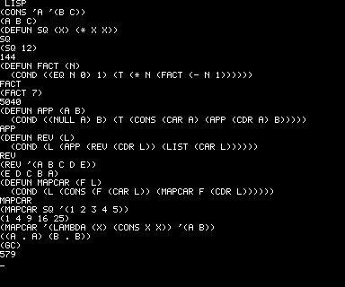

# COMP80 LISP

A small LISP for the PSI COMP80 that replaces BURP in the ROM, in the same
way as [COMP80 FORTH](../forth/README.md). The monitor (0000-03FF) is
unchanged; LISP fills the 2 KB at 0400-0BFF where BURP was. As with BURP,
you enter it with the RS key from the monitor's READY state.

## Running it

The MAME driver has the ROM as a BIOS option; BURP stays the default.

    ~/localdev/psicomp80/c80.sh lisp

or by hand:

    cd ~/localdev/mame && ./mamed psicomp80 -bios lisp

then press `^` (RS) at READY. The top line changes to LISP and a `_` cursor
appears. Type an expression and press Return; LISP prints its value. An
expression can run over several lines: LISP keeps reading until the
brackets balance. Several expressions on one line are each evaluated in turn.

It also runs on the machine with the 32 KB expansion (`c80.sh 32k lisp`,
or `./mamed psicomp80x -bios lisp`), and uses the extra memory there.

## Example programs

`examples/` has fourteen LISP programs to type in (or let `c80.sh` type them):

| | |
|---|---|
| `deriv.lsp` | Symbolic differentiation, the program LISP was made for. `(DERIV '(+ (* 3 (EXPT X 2)) (* 2 X)) 'X)` gives `(+ (* 6 X) 2)`. `~/localdev/psicomp80/c80.sh deriv` |
| `hanoi.lsp` | The Towers of Hanoi. `(HANOI 4 'A 'C 'B)` prints the 15 moves. `~/localdev/psicomp80/c80.sh hanoi` |
| `queens.lsp` | The eight queens. `(QUEENS 8)` prints the first solution as a board, in about 26 s in the emulator. `~/localdev/psicomp80/c80.sh queens` |
| `sier.lsp` | The Sierpiński triangle: 16 rows of Pascal's triangle mod 2, printed with `TYO`. `(SIER)` takes about 6 s. `~/localdev/psicomp80/c80.sh lispsier` |
| `hilbert.lsp` | A Hilbert curve, 16 × 16 points, printed a line at a time: each point's distance along the curve is worked out a quarter at a time, and neighbours whose distances differ by 1 are joined. `(HILBERT)` takes about 30 s. `~/localdev/psicomp80/c80.sh lisphilbert` |
| `eliza.lsp` | A little Eliza. `(TALK '(I FEEL SAD ABOUT MY JOB))` answers `(WHY DO YOU FEEL SAD ABOUT YOUR JOB)`; with no keyword it says something dull. Each new word takes a slot in the symbol table, so about 30 new words fit. `~/localdev/psicomp80/c80.sh eliza` |
| `simp.lsp` | Simplifying algebra. `(D '(* X X) 'X)` gives `(+ (* X 1) (* 1 X))`; `(SIMP (D '(* X X) 'X))` gives `(* 2 X)`. It has its own D, as DERIV and SIMP together don't fit in 8 KB. `~/localdev/psicomp80/c80.sh simp` |
| `perms.lsp` | Permutations and the power set. `(PERMS '(A B C))` gives the six orders; `(POWER '(A B C))` gives the eight subsets. `~/localdev/psicomp80/c80.sh perms` |
| `fib.lsp` | Fibonacci and Ackermann, counting calls. `(CALLS FIB 15)` gives `(610 IN 1973 CALLS)` in about 8 s; `(FAST 22)` overflows the 15-bit numbers; `(ACK 3 3)` is `TOO DEEP` without the 32 KB expansion. `~/localdev/psicomp80/c80.sh fib` |
| `animal.lsp` | The animal game, which learns: `(PLAY)`, then `(YES)` or `(NO)`; when it guesses wrong, `(ITS 'DOG '(DOES IT BARK))` grows the tree. `~/localdev/psicomp80/c80.sh animal` |
| `unify.lsp` | Unification with variables written `(? X)`, and a little depth-first prover over parent facts and a GRAND rule: `(QUERY '((GRAND TOM (? W))))` prints both grandchildren in about 12 s. `~/localdev/psicomp80/c80.sh unify` |
| `eval.lsp` | LISP in LISP: EV and AP evaluate QUOTE, COND, LAMBDA and five primitives with an environment list; `(EV '(APP (QUOTE (A B)) (QUOTE (C D E))) ENV)` gives `(A B C D E)`. `~/localdev/psicomp80/c80.sh eval` |
| `river.lsp` | Missionaries and cannibals by depth-first search; `(CROSS)` prints the 11 crossings as banks and boat, in about 5 s. `~/localdev/psicomp80/c80.sh river` |
| `roman.lsp` | Roman numerals both ways and numbers in words: `(ROMAN 1987)` gives `(M C M L X X X V I I)`, `NUMERAL` turns it back, `(WORDS 1987)` gives `(ONE THOUSAND NINE HUNDRED AND EIGHTY SEVEN)`. `~/localdev/psicomp80/c80.sh roman` |

`load.lua` does the typing: it enters LISP and types the file a line at a
time, leaving out comment lines and waiting for LISP's cursor between lines
(a key while LISP is busy resets to the monitor), with the emulator running
flat out. Then it types the run line at normal speed. `screens/` has
screenshots of the first three, made by `screens.sh`; they are also on `../lisp.html`.

Without the expansion there is room for one of these programs at a time:
DERIV takes about 380 of the 672 cells, QUEENS about 190.

## Keys

| Key | What it does |
|---|---|
| Return | end the line |
| `^` (RS) | rub out the last character. In MAME, Backspace does the same. |
| Ctrl+`\` (FS) | back to the monitor |
| any key while a program runs | stops it: the COMP80 resets to the monitor (READY) |
| `^` at READY | back into LISP, with your functions still there |

The keyboard is upper case only, and `_` acts as Return (the monitor's
keyboard handling, which the ROM keeps). Lines can be up to 79 characters.

## The language

LISP 1.5 style, with dynamic scope.

| | |
|---|---|
| Special forms | `QUOTE` (and `'x`), `COND`, `LAMBDA`, `DEFUN`, `SETQ`, `AND`, `OR` |
| Lists | `CAR CDR CONS LIST CADR CADDR` |
| Tests | `ATOM EQ NULL NUMBERP` (true is `T`, false is `NIL`) |
| Arithmetic | `+ - * / REM < >` (two arguments each) |
| Output | `PRINT PRIN1 TERPRI TYO` |
| Other | `EVAL GC` |

- Numbers are integers from -16384 to 16383 (15 bits); arithmetic wraps
  round without warning. `/` and `REM` round towards zero. `EQ` compares
  numbers too.
- Symbols are any run of characters other than space, `( ) '` and `;`,
  that isn't a number. Characters below `*` (`! " # $ % &`) end a symbol.
- `NIL` is the empty list and false; anything else is true. `T` is `T`.
- `(DEFUN name (params) body...)` sets `name` to `(LAMBDA (params) body...)`
  and returns the name. A function is just a value: `(MAPCAR SQ L)` passes
  SQ's lambda list, and `(F X)` calls whatever F holds. A quoted
  `'(LAMBDA ...)` works as a function too.
- Bodies of `LAMBDA`, `DEFUN` and `COND` clauses can have several
  expressions; the last one's value is the result.
- Missing arguments are `NIL`; extra ones are ignored.
- `(PRINT x)` prints x and a new line; `(PRIN1 x)` prints it without one;
  `(TERPRI)` starts a new line; `(TYO n)` prints character code n (13 is a
  new line, 128-191 are the graphics characters, 143 a solid block).
- `(GC)` collects garbage now and returns the number of free cells.
- `;` starts a comment to the end of the line.

Variables are dynamically scoped, as in the original LISP: a function sees
the variables of whatever called it, unless it has a parameter of the same
name. `queens.lsp` uses this, and it is the classic "funarg" pitfall: a
function passed as an argument sees the variables of the function it is
passed to, not of the one it was written in.

Errors print a message and the object at fault, then LISP waits for the
next line; whatever was being evaluated is abandoned and every variable gets
its old value back.

| Message | Meaning |
|---|---|
| `UNBOUND X` | X has no value |
| `BAD FN X` | X is not a function |
| `BAD ARG X` | X is the wrong kind of argument: CAR of a non-list, arithmetic on a non-number, or SETQ, DEFUN or a parameter that isn't a symbol |
| `TOO DEEP` | the recursion went too deep for the stack |
| `NO MEM` | the cells or the symbol table are full |

Not included (2 KB is tight): `IF`, `LET`, `PROG` and `GO`, strings,
`RPLACA` and `RPLACD`, `APPLY`, `READ`, dotted pairs on input (they print,
as in `(A . B)`, but can't be typed), and floating point. `APPEND`,
`REVERSE`, `MAPCAR`, `EQUAL` and the like are a few lines of LISP each.

## Memory

| Address | Use |
|---|---|
| 0C00-0C15 | variables |
| 0C20-0EFF | symbol table: about 220 bytes of built-ins, then yours (room for 60 or so names) |
| 0F00-0FA0 | input line and the atom being read |
| 1000-1A7F | 672 cells of 4 bytes |
| 1A80-1AD3 | mark bitmap for the garbage collector |
| 1AD4-1EFF | binding stack (up) and Z80 stack (down): recursion about 45 calls deep |
| 1F00-1FFF | left for the monitor |

With the 32 KB expansion the cells move to 8800-FFFF (7680 of them), the
bitmap to 1000-13BF, and the stacks get 13C0-1EFF, enough for about 140
calls. LISP looks for the expansion when it starts from cold.

Everything lives in RAM, so a trip to the monitor and back keeps it.

## Inside

Objects are 16-bit words. `NIL` is 0; a number n is 2n+1, so odd; a symbol
is the address of its record in the symbol table (value, length, name); a
cell is the address of 4 bytes in the heap (car, cdr), and anything even from
1000h up is a cell; a built-in function is 2k, for built-in number k. The
symbol table starts as a copy of the built-in names, each with its built-in
as its value, so `CAR` evaluates to the built-in that `(CAR X)` then calls.

The evaluator is recursive machine code. Calling a LAMBDA evaluates the
arguments into a list, saves the old values of the parameters on the binding
stack, stores the new ones in the symbols, evaluates the body, and puts the
old values back (shallow binding). An error unwinds the binding stack.

Garbage collection is mark and sweep with a bitmap. The roots are the
symbol table, the binding stack and the Z80 stack, which is scanned
conservatively (any word on it that could be a cell is kept), so the machine
code only has to have what it still needs on the stack when it conses.

Keys and the screen work as in FORTH: keys come from the monitor's NMI
handler, which only takes a key while the CPU is halted, so LISP waits for a
key with a HALT and anything else resets to the monitor; RS while waiting is
rubout. Game of Life (`life/`) keeps working with this ROM: the two ROM words
it uses at 06B4 are kept.

## Building

    lisp/build.sh

assembles `lisp.asm` with z80asm (`brew install z80asm`), writes `lisp.bin`
(0400-0BFF) and `../psicomp80_lisp.rom` (monitor + LISP), and puts the new
ROM's CRC and SHA1 into `../psicomp80.cpp`. Then run `mame/install.sh` and
rebuild MAME.

## Tests

`test_lisp.lua` types a session from a file in `tests/` and prints the
screen:

    cd ~/localdev/mame && LISP_TEST=~/localdev/psicomp80/lisp/tests/basic.txt \
      ./mamed psicomp80 -bios lisp -video none -sound none -nothrottle \
      -autoboot_script ~/localdev/psicomp80/lisp/test_lisp.lua

With `LISP_BIN=~/localdev/psicomp80/lisp/lisp.bin` and no `-bios lisp`,
it patches a freshly built `lisp.bin` into the ROM first, so you can try
changes without rebuilding MAME.

- `basic.txt`: lists, arithmetic, DEFUN, recursion, LAMBDA, AND and OR,
  printing, multi-line input, comments, dynamic binding
- `errors.txt`: each error message, TOO DEEP, odd atoms, rubout
- `break.txt`: recursion depth, stopping a running function, coming back
  with RS (bindings restored), garbage collection
- `gc.txt`: a tree kept intact through many collections
- `bios.txt`: the Backspace key under `-bios lisp`
- `demo.txt`: the session in the picture above
- `sier.txt`: `sier.lsp` typed in and run
- `hilbert.txt`: `hilbert.lsp` typed in and run
- `eliza.txt`, `simp.txt`, `perms.txt`, `fib.txt`, `animal.txt`, `unify.txt`, `eval.txt`, `river.txt`, `roman.txt`: each example typed in and its sample lines run
