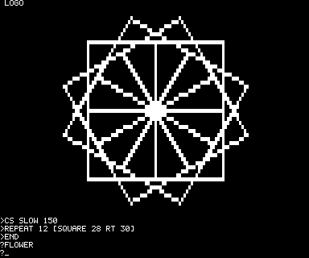

# COMP80 LOGO

A small Logo for the PSI COMP80 that replaces BURP in the ROM. The monitor
(0000-03FF) is unchanged; Logo fills the 2 KB at 0400-0BFF where BURP was.
As with BURP, you enter it with the RS key from the monitor's READY state.
It has turtle graphics on the quarter-block screen, procedures with inputs
and recursion, OUTPUT, variables, REPEAT and IF.

## Running it

    sh logo/build.sh

builds `psicomp80_logo.rom`. Once the MAME driver and the web page have it
as a ROM choice, press `^` (RS) at READY. The top line changes to LOGO and
a `?` prompt and a `_` cursor appear at the bottom. Type a line and press
Return; the line runs.

## The screen

Line 0 shows LOGO. Lines 1-26 are the turtle's field, 128 × 52 points, four
to a character using the quarter-block graphics. Lines 27-31 are for typing
and printing, and scroll on their own, leaving the drawing alone.

A quarter character is 3 units wide and 5 tall on the screen, so a turtle
step is one point across but 0.6 of a point up or down: `REPEAT 4 [FD 40 RT
90]` draws a square that looks square. The field is 128 steps across and 86
up, with HOME, (0, 0), in the middle. The heading is in degrees, 0 straight
up, turning clockwise. Points off the field aren't drawn; the turtle keeps
its position, up to 128 points from home, beyond which it comes back in on
the other side.

## Example programs

`examples/` has five programs to type in. Each defines procedures; the
last word in the table runs it.

| | |
|---|---|
| `flower.logo` | Twelve squares, each turned 30° from the last. `FLOWER`, about 3 s. |
| `spiral.logo` | A square spiral that twists: each side 2 longer than the last, turning `:A` degrees, with a global variable made by MAKE. `SPIRAL 91`, about 3 s; try `SPIRAL 89` or `SPIRAL 121`. |
| `tree.logo` | A recursive tree: a trunk with two smaller trees on top, each two thirds the size, until they are smaller than 5. `FOREST`, about 3 s. |
| `flake.logo` | A Koch snowflake: each side of a triangle becomes four with a point in the middle, `:N` times over. `FLAKE 3`, about 5 s. |
| `stars.logo` | Sixteen five-pointed stars of random sizes in random places. `SKY`, about 2 s. |

## Keys

- Return runs the line.
- Backspace (RS) rubs out the last character.
- Any key while a program runs stops it and goes back to the monitor; RS
  comes back to Logo with the procedures kept.
- FS (Ctrl+\\) goes back to the monitor.

## The language

A line is a run of words: numbers, `:NAME` (a variable's value), `"NAME` (a
quoted word), and the single characters `[ ] ( ) + - * / < = >`, which need
no spaces round them. A `-` after a space and before a digit starts a
negative number, so `SETXY 0 -40` is two numbers and `:A -1` is two values;
`:A - 1` and `:A-1` subtract. `;` starts a comment that runs to the end of
the line. Numbers are 16-bit signed integers.

Turtle:

| | |
|---|---|
| `FD n`, `BK n` | Move forward or back n steps, drawing a point at each step if the pen is down. |
| `RT n`, `LT n` | Turn right (clockwise) or left n degrees. |
| `SETH n` | Point at heading n. |
| `SETXY x y` | Move to (x, y) without drawing. |
| `HOME` | Back to (0, 0), heading 0, without drawing. |
| `CS` | Clear the field and go HOME. |
| `PU`, `PD`, `PE` | Pen up, pen down, pen erase (rubs out points as it goes). |
| `SLOW n` | A pause at every step, 0 (none, to start with) to 255, so you can watch the turtle. |
| `WAIT n` | Wait n sixtieths of a second. |

Control:

| | |
|---|---|
| `REPEAT n [ ... ]` | Run the list n times. |
| `IF test [ ... ]` | Run the list if the test isn't 0. |
| `IF test [ ... ] [ ... ]` | Run the first list if the test isn't 0, the second if it is. |
| `TO NAME :A :B ... END` | Define a procedure with inputs `:A`, `:B`. It can go over many lines; until END the prompt is `>`. Defining a name again replaces it. |
| `STOP` | Leave the procedure. |
| `OUTPUT x` | Leave the procedure, which gives x as its value. |
| `MAKE "NAME x` | Set the variable NAME, making a global one if there isn't one. |
| `PRINT x`, `PRINT "WORD`, `PRINT [ ... ]` | Print a number, a word, or the words in the list. |
| `ERALL` | Forget every procedure and global variable. |

Values: a number, `:NAME`, `( ... )`, `- x`, `RANDOM n` (0 to n − 1), or a
procedure that OUTPUTs, followed by its inputs. `*` and `/` come before `+`
and `-`; a comparison `<`, `=` or `>` gives 1 or 0 and comes last. `/`
rounds towards 0.

A procedure's inputs are worked out before it starts, and last until it
ends. Scope is dynamic, as in other Logos: a procedure sees the inputs of
the procedures that called it, and MAKE sets the newest variable of that
name.

    TO FACT :N
    IF :N = 0 [OUTPUT 1]
    OUTPUT :N * FACT :N - 1
    END
    PRINT FACT 7

prints 5040. An unknown word is printed with `?` after it, and Logo goes
back to the prompt; `DEEP ?` means the procedures called each other about
100 deep, which is as far as the stack goes.

## Memory

| | |
|---|---|
| 0C00 | Magic number (4C47h when the procedures are valid), newest procedure, first free byte, lowest global |
| 0C08 | Procedures, upwards: a link to the one before, then the words from the name to the word before END, a space apart, and a 0. A global's name is kept here too. |
| below 1700 | Global variables, downwards: name address and value |
| 1700-19FF | Procedure inputs, upwards, while a procedure runs |
| 1A00 | Input line |
| 1A60 | Cursor position (the `_` cursor, 1Fh, is there while Logo waits for a line), then the interpreter's and the turtle's variables |
| 1AC0-1F00 | Stack |

The procedures survive going back to the monitor, as long as nothing writes
over 0C00. The 32 KB expansion isn't used.

## Inside

The interpreter works on the text. A procedure is kept as its words, and
running it reads them again each time; there is no compiling. A word is
looked up in the table of commands first, then the procedures, newest first.
Calling a procedure reads its title line: for each `:NAME` it works out a
value from the words after the call, keeping it on the stack, and when all
are worked out it pushes each name and value above the variables. `STOP` and
`OUTPUT` put the stack back to where the procedure started, wherever they
are inside its REPEATs and IFs.

The turtle's position is kept in points with 8 bits of fraction. A step
adds 256 × the sine of the heading across and 154 × its cosine up (0.6 ×
256). The sine comes from Bhaskara's formula, 4t / (40500 − t) with t = x
(180 − x), which is within about 1% and takes much less room than a table.

## Building

    sh logo/build.sh

assembles `logo.asm` with z80asm and puts the monitor from `psicomp80.rom`
in front of it to make `psicomp80_logo.rom`. It stops if z80asm says
anything at all, since z80asm writes a `.bin` even after some errors.

## Tests

`tests/` has a session for each example (typed in, run, the screen printed
at the end) and `basics.txt`, which tries the arithmetic, OUTPUT, MAKE, IF
and an unknown word. They are in the same form as `../forth/tests/`.
